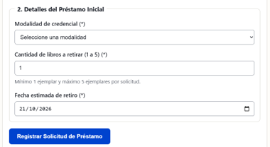
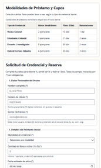
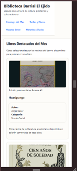
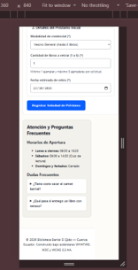
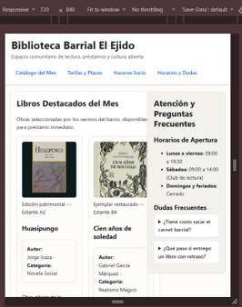
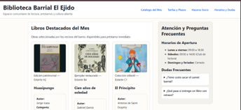
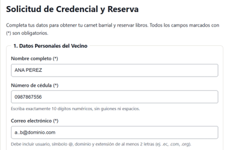
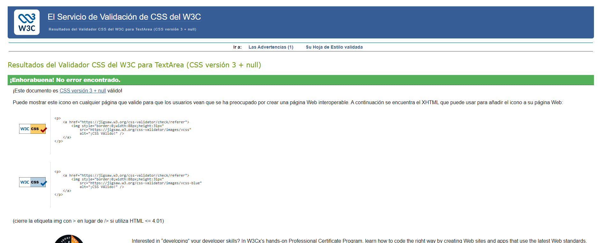
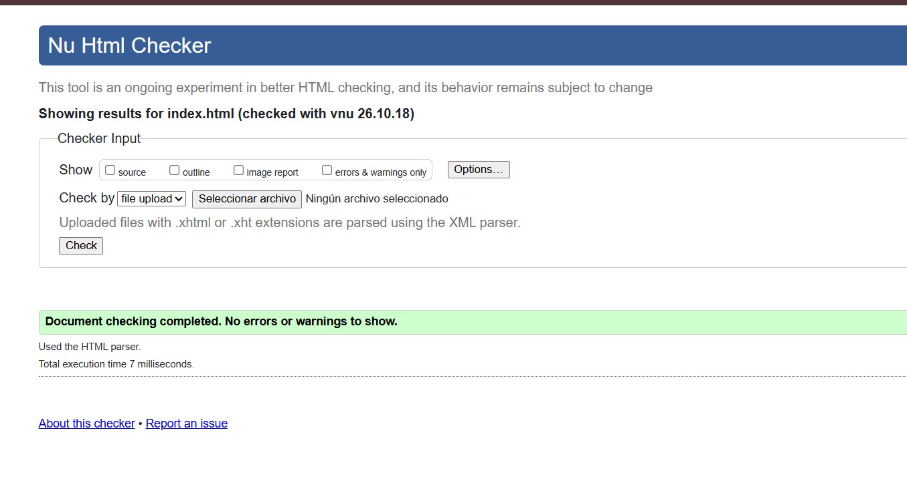
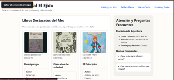

# Informe de auditoría: página del N.º de lista 25

**Auditor:** N.º de lista 26, Cristina Loja

**Compañero auditado:** N.º de lista 25, Michael Yumbla

**Página revisada:** https://michael2454555.github.io/-Practica---Est-ndares-HTML-Biblioteca-Barrial/

**Repositorio:** https://github.com/Michael2454555/-Practica---Est-ndares-HTML-Biblioteca-Barrial

**Fecha de la sesión:** 22/10/2026

## 1. Tu ficha

| N.º de lista | Temática | Campos especiales del formulario | Breakpoint principal | Restricción especial |
|---|---|---|---|---|
| 25 | Biblioteca barrial | Correo con pattern personalizado | 720 px | Tipografía fluida con clamp(), sin media queries para tamaños de texto |

## 2. Qué esperaba encontrar y qué encontré

| Requisito | Qué esperaba encontrar | Qué encontré |
|---|---|---|
| Base 1: estructura semántica | Que tenga cabecera, menú, contenido principal, al menos dos secciones con título, una barra lateral y un pie de página, y que los títulos bajen en orden (h1, h2, h3) sin saltarse niveles. | Todo eso está y los títulos bajan en orden. Cumple. |
| Base 2: formulario | Cinco campos o más, cada uno con su etiqueta, el tipo de campo adecuado, validación del navegador y grupos con fieldset y legend. | Hay 6 campos y cada uno tiene su etiqueta. Usan los tipos texto, correo, número, fecha y lista desplegable, con required, pattern, min y max, y hay dos fieldset con legend. Cumple, menos un detalle en la fecha (hallazgo 1). |
| Base 3: tabla | Que la tabla tenga caption, thead, tbody y scope en los encabezados. | Tiene caption, thead y tbody, y `scope="col"` en las columnas. Falla el scope de las filas (hallazgo 2). |
| Base 4: layout responsive | Grid para la estructura, Flexbox en un componente y que no haya scroll horizontal a 360 px. | Sí usa Grid (`.layout-principal`, `main`, `.catalogo-grid`) y Flexbox (cabecera, menú, campos). Pero a 360 px aparece scroll horizontal (hallazgo 3), a 720 px una parte se tapa (hallazgo 4) y hay una clase mal usada (hallazgo 5). |
| Base 5: variables CSS y contraste | Colores guardados como variables `--color-...` y buen contraste (mínimo 4.5:1). | Las variables están en `:root`. Calculé el contraste: el texto principal tiene cerca de 16:1, el secundario cerca de 8:1 y el azul sobre blanco 5.1:1 (4.5:1 sobre el gris del hover). Cumple. |
| Base 6: teclado y foco | Enlace para saltar al contenido, que se pueda recorrer todo con Tab y Shift+Tab, y que se vea dónde está el foco. | Recorrí toda la página con Tab y Shift+Tab. El orden tiene sentido (enlace de salto, menú, campos, botón y preguntas del lateral) y el borde naranja del foco se ve en todos los elementos. Cumple. |
| Base 7: validadores | Cero errores en el validador de HTML y en el de CSS. | HTML sin errores ni advertencias y CSS sin errores. Cumple. |
| Base 8: imágenes con alt | Un texto alternativo (alt) adecuado en cada imagen. | Las tres portadas tienen un alt que dice el título y el autor del libro. Cumple. |
| Ficha: temática y ficha.md | Que el contenido sea de una biblioteca barrial y que `docs/ficha.md` tenga la fila 25 completa. | Todo el contenido es de la biblioteca (libros, préstamos, socios y horarios) y `docs/ficha.md` tiene la fila 25 igual que en la guía. Cumple. |
| Ficha: correo con pattern | Un campo de correo con un pattern propio y su etiqueta. | Existe `#correo` con `type="email"`, pattern, etiqueta y texto de ayuda. Pero el patrón deja pasar demasiado (hallazgo 6). |
| Ficha: breakpoint de 720 px | Una media query principal en 720px. | Existe `@media (min-width: 720px)`, pero a ese ancho una parte de la página se tapa (hallazgo 4). |
| Ficha: clamp() sin media queries de texto | Tamaños de letra con clamp() y ninguna media query que cambie el tamaño del texto. | Los `font-size` usan clamp() y la única media query solo cambia la distribución de la página. Cumple. |
| Historial de commits | Que el trabajo se haya hecho por etapas y no subido todo de una vez. | El repositorio tiene 6 commits que muestran el avance: ficha, imágenes, tabla y formulario, contrastes y layout, y ajustes de estilo. Cumple. |

## 3. Informe de auditoría

| N.º | Requisito | Ubicación (archivo y línea o selector) | Hallazgo | Norma que incumple | Evidencia | Severidad (alta, media, baja) |
|---|---|---|---|---|---|---|
| 1 | Base 2: formulario | `index.html`, línea 163: `input#fecha-retiro` (`min="2026-10-21" max="2026-12-31"`) | El campo de fecha tiene escrita a mano la fecha mínima en el código. Hoy es 22/10/2026 y aun así deja elegir el 21/10, que ya pasó; además, con los días esa fecha quedará vieja. Y a diferencia de la cédula, el correo y la cantidad, este campo no tiene un texto de ayuda que diga qué fechas se pueden elegir (hasta el 31/12/2026). | WCAG 2.2, criterio 3.3.2 (Etiquetas o instrucciones). | Código del campo y captura eligiendo el 21/10/2026.  | Baja |
| 2 | Base 3: tabla accesible | `index.html`, líneas 85, 91, 97 y 103: `<th scope="rowgroup">` en el `<tbody>` | Los nombres de las filas (Vecino General, Estudiante / Infantil, Docente / Investigador y Club de Lectura Sábados) tienen `scope="rowgroup"`. Ese valor se usa cuando un encabezado cubre varias filas juntas. Como aquí cada encabezado es de una sola fila, debería ser `scope="row"`. Por eso, la regla del CSS `tbody th[scope="row"]` (línea 231) no se aplica a ninguna celda. | WHATWG HTML, atributo `scope` del elemento `th`. WCAG 2.2, criterio 1.3.1 (Información y relaciones). | Código de la tabla (4 veces `scope="rowgroup"`) y captura de la tabla.  | Media |
| 3 | Base 4: layout responsive (360 px) | `estilos.css`, líneas 145 y 151: `grid-template-columns: 1fr` en `.layout-principal` y `main` | Al abrir la página con 360 px de ancho aparece scroll horizontal. En la consola, `document.documentElement.scrollWidth` da 476, o sea 116 px más que el ancho de la pantalla. Las tres secciones de `main` miden 476 px, y se nota porque el fondo blanco del encabezado y del pie termina antes que el contenido. | WCAG 2.2, criterio 1.4.10 (Reflow). Requisito base 4 de la guía (sin scroll horizontal en 360 px). | Consola a 360 px: `scrollWidth = 476`.   | Alta |
| 4 | Base 4: layout y ficha (breakpoint 720 px) | `estilos.css`, líneas 319 a 328: `@media (min-width: 720px)` | Justo en el ancho de tu ficha (720 px), la barra lateral de preguntas frecuentes queda encima de la columna principal: se corta el párrafo de introducción y se tapa la tercera tarjeta de libros. A ese ancho las dos columnas no se ven bien. | Requisito base 4 de la guía (layout responsive). Ficha 25: breakpoint principal 720 px. | Vista Responsive de DevTools a 720 x 840.  | Alta |
| 5 | Base 4: Layout y CSS (cascada) | `index.html`, líneas 42, 52 y 62: `
`; `estilos.css`, línea 177: `.libro-card` | Los párrafos de Autor y Categoría usan la misma clase que la tarjeta completa (`libro-card`). Por eso reciben su borde, relleno, fondo y `display: flex`. El resultado es una caja dentro de otra en cada tarjeta, con el texto apilado. En el CSS existe la clase `libro-meta` (línea 64), que no se usa en el HTML y parece ser la que se quería poner. | Rúbrica, criterio "Layout y CSS" (cascada mal aplicada). No es una norma WCAG. | Captura de la caja dentro de la caja y del panel Styles del `
`.  | Media |
| 6 | Ficha: correo con pattern | `index.html`, línea 136: `input#correo` (atributo `pattern`) | El patrón del correo deja pasar direcciones raras. La parte antes de la @ acepta puntos sin límite, así que valores como `a..b@dominio.com` cumplen el patrón. Para ser un pattern personalizado, debería pedir que no empiece ni termine con punto y que no haya dos puntos seguidos. | WHATWG HTML, atributo `pattern` (debe describir el formato válido). Ficha 25: correo con pattern personalizado. | Prueba con el valor `a..b@dominio.com` en el formulario.  | Baja |

## 4. Evidencia de los validadores y del teclado

**Validador CSS (W3C): sin errores**

**Validador HTML (Nu Html Checker): sin errores ni advertencias**

**Foco visible en el skip-link**

## 5. Sugerencias menores

- El select dice "hasta 2 libros" para Vecino General, pero el campo de cantidad deja pedir hasta 5 sin importar lo elegido. Alguien con ese carnet podría pedir 5 libros y el formulario no avisa.
- Las imágenes tienen `height: 180px` con `object-fit: cover`, y eso corta las portadas: en Huasipungo y El Principito se pierde la parte de arriba.
- Las variables `--color-exito` y `--color-error` están creadas en `:root` pero no se usan en ninguna regla.

## 6. Fuentes

- WCAG 3.3.2, Labels or Instructions: https://www.w3.org/WAI/WCAG21/Understanding/labels-or-instructions
- WHATWG, atributo scope de th: https://html.spec.whatwg.org/multipage/tables.html#attr-th-scope
- MDN, elemento th: https://developer.mozilla.org/es/docs/Web/HTML/Elemento/th
- WCAG, técnica H63 (scope en tablas): https://www.w3.org/WAI/WCAG22/Techniques/html/H63.html
- WCAG 1.4.10, Reflow: https://www.w3.org/WAI/WCAG22/Understanding/reflow
- W3C CSS, significado de 1fr: https://lists.w3.org/Archives/Public/public-css-archive/2017Sep/0018.html
- Makandra, desborde con 1fr: https://makandracards.com/makandra/608104
- MDN, atributo pattern: https://docs.w3cub.com/html/reference/attributes/pattern
- MDN, input type email: https://developer.mozilla.org/es/docs/Web/HTML/Elemento/input/email
- Validador HTML (Nu): https://validator.w3.org/nu/
- Validador CSS (W3C): https://jigsaw.w3.org/css-validator/
