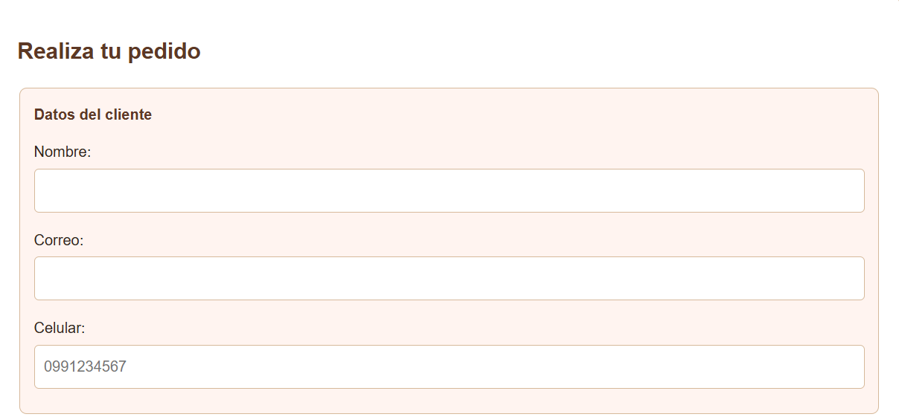
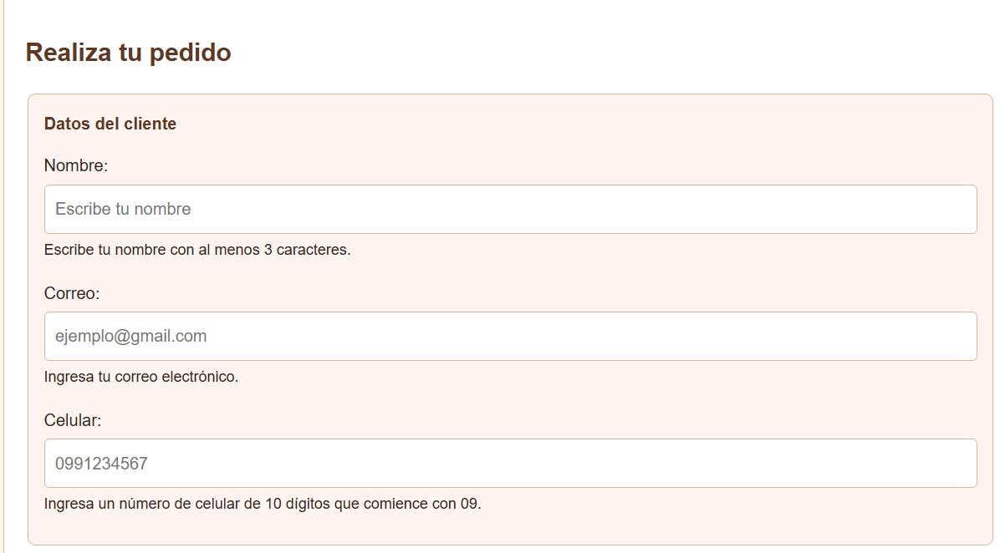
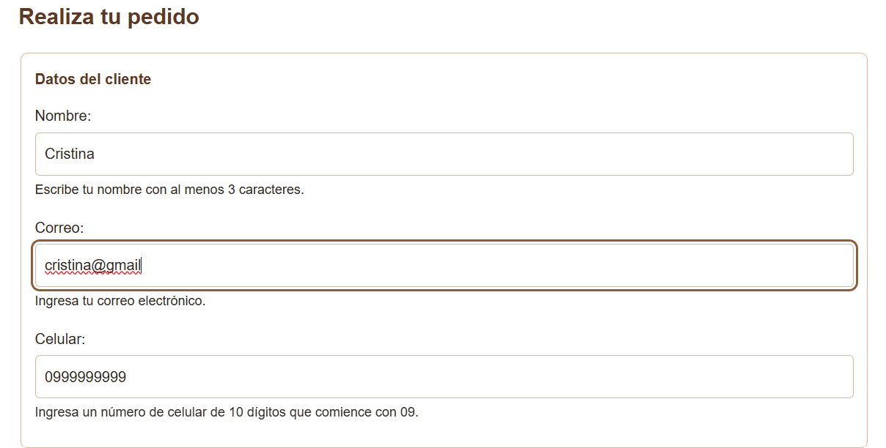
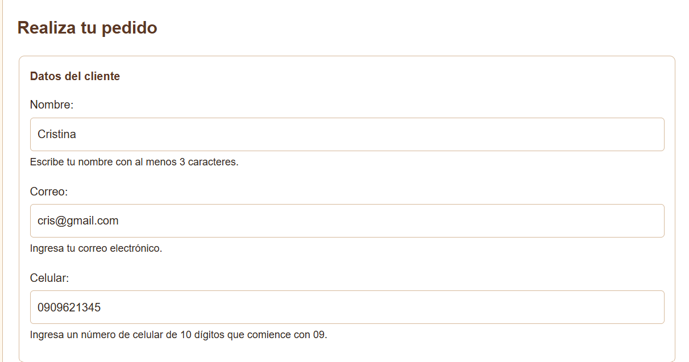

# Respuesta a la auditoría recibida

**Auditor:** Jonnathan Saavedra  
**Proyecto auditado:** Aroma Café

En la auditoría recibida no se identificaron incumplimientos confirmados. Sin embargo, realicé mejoras adicionales en el formulario de pedidos para que las indicaciones de los campos sean más claras para los usuarios y reforzar la validación del correo electrónico.

| N.º de hallazgo | Decisión (acepta o refuta) | Justificación con la norma | Evidencia antes y después | Commit |
|---|---|---|---|---|
| No aplica (mejora adicional) | No aplica | El auditor no registró un hallazgo específico en los campos de nombre, correo y celular. Por iniciativa propia, mejoré las indicaciones del formulario mediante ejemplos en los campos y mensajes de ayuda. Se conservaron las etiquetas asociadas a los controles y las validaciones HTML existentes. | **Antes:** los campos no mostraban mensajes de ayuda debajo de ellos. **Después:** se añadieron textos que explican qué información ingresar en nombre, correo y celular. Podemos observar las capturas en la sección de evidencias en la parte superior. | `Agregar mensajes de ayuda al formulario` |
| No aplica (mejora adicional) | No aplica | Se añadió el atributo `pattern=".+@.+\..+"` al campo de correo para exigir un punto después de la arroba, complementando la validación de `type="email"` y `required`. | **Antes:** el campo utilizaba la validación básica de `type="email"`. **Después:** también se comprueba el formato definido por el patrón. Podemos observar las capturas en la sección de evidencias en la parte superior. | `Mejorar validación del correo electrónico` |

## Mejoras adicionales realizadas

- **Nombre:** se agregó un ejemplo en el campo y un mensaje que indica que se requieren al menos tres caracteres.
- **Correo:** se añadió un ejemplo y un mensaje de ayuda. Además, se incorporó un patrón para reforzar la validación del formato del correo electrónico.
- **Celular:** se agregó un mensaje que explica que el número debe tener diez dígitos y comenzar con `09`.

Estas mejoras buscan facilitar el llenado del formulario, orientar a los usuarios y reducir errores al ingresar sus datos, sin modificar la estructura general de la página.

## Evidencias

### 1. Mensajes de ayuda del formulario

**Antes de la mejora**

**Después de la mejora**

### 2. Validación del correo electrónico

**Antes de agregar el patrón**

**Después de agregar el patrón**

